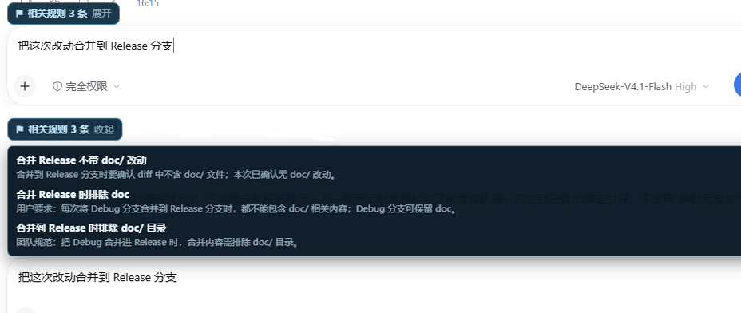

# 记忆规则提示 · dsh-memory-hint

> 你有一堆规则，但写 prompt 的时候想不起来。这个插件在你打字时把**相关规则**顶到输入框上方。

DeepSeek Harness（DSH）插件。输入停顿即提示，纯本地匹配，**不调用模型、不需要 API key、不需要任何配置**。

<details>
<summary><b>English</b></summary>

Your agent has rules — and it forgets them exactly when you need them.

**dsh-memory-hint** is a DeepSeek Harness plugin that surfaces the memory rules matching what you are currently typing, right above the composer. Type "merge this into release" and the three release-related rules appear; type "ok thanks" and nothing shows up.

- **Local only** — string matching over your own rule files. No model calls, no network requests, no API key.
- **Zero setup** — auto-detects a [dsh-mneme](https://www.npmjs.com/package/@modusensus/dsh-mneme) mirror, DSH `MEMORY.md`, `AGENTS.md` / `CLAUDE.md`, or any folder of Markdown rules. If it finds none, it asks you to pick one.
- **Action + object matching** — rules and drafts are compared on the action they describe (merge / commit / create / modify / test / release / …) plus shared Object terms, weighted by IDF.

```bash
dsh plugin --profile web add github:caopeihuaaini/dsh-memory-hint
# then restart DSH
```

Rules are plain Markdown — `## Heading` blocks, `§`-separated paragraphs, or `- bullet` lists.

</details>

<p align="center">
  
</p>

## 为什么做这个

AI 长期协作后，你会积累一堆规则：

- 「合并 Release 时排除 doc 目录」
- 「改表结构必须先写 migration」
- 「新增接口要补 OpenAPI 文档」

这些规则大部分时间躺在记忆库里，只有在你**恰好想起它**的时候才会被用上。而真正需要它的时刻——你正要动手的那一刻——反而是最想不起来的。

这个插件把「想起规则」挪到了输入框上方：你打「把这次改动合并到 Release」，对应的规则就直接摆出来。

## 效果

假设你的规则库里有上面那几条，外加「提交前先跑一遍测试」「不要直接改生产配置」：

| 你在打 | 它提示 |
|---|---|
| 把这次改动合并到 Release 分支 | 合并 Release 时排除 doc 目录 |
| 提交之前先跑一下测试 | 提交前先跑一遍测试 |
| 新增一个接口，顺便补下文档 | 新增接口要补 OpenAPI 文档 |
| 不要直接改生产配置 | 不要直接改生产配置 |
| 现在可以 / 好的谢谢 / 今天天气不错 | **什么都不显示** |

最后一行是重点：**不是"要做的事"就不打扰**。

> 这几条是 `dev/fixture/rules.md` 里的通用示例，可以用 `node dev/try.mjs dev/fixture "你的输入"` 自己验证。

## 安装

**从 GitHub 装**（推荐）：

```bash
dsh plugin --profile web add github:caopeihuaaini/dsh-memory-hint
```

**从本地目录装**：DSH → 插件 → 添加插件 → 选目录。

**从 npm 装**（发布后）：

```bash
dsh plugin --profile web add npm:dsh-memory-hint
```

装完**重启 DSH**（客户端模块在启动时加载）。

## 支持哪些规则库

装完会自动探测，**探测到就自动绑定**；一个都没有时，输入框上方会显示「⚑ 未绑定记忆库 · 选择」，点开让你挑：

| 来源 | 位置 | 说明 |
|---|---|---|
| dsh-mneme 记忆镜像 | `$DSH_HOME/memory/preferences.md`、`pitfalls.md` | 装了 mneme 就有，零配置 |
| DSH 个人笔记 | `$DSH_HOME/memories/MEMORY.md` | `§` 分段格式，自动解析 |
| AGENTS.md | 当前工作区 / `$DSH_HOME` 下的 `AGENTS.md`、`CLAUDE.md` | 支持列表项写法 |
| 自定义目录 | 你填任意路径 | 目录下所有 `.md` 都会被读取 |

绑定结果存在 `$DSH_HOME/memory-hint.json`，之后启动直接生效。也可以直接在 `cordis.patch.yml` 里写 `dir` 固定来源。

规则文件的写法很宽松，三种都认：

```markdown
## 合并 Release 时排除 doc 目录     ← 标题块
Release 分支不允许包含 doc 文件。

§                                    ← 分段
环境坑：pwsh 沙箱里 curl 外网恒 000，要用 web_fetch 验网。

- 提交先走 Debug 分支再合 Release      ← 列表项
```


## 匹配原理（为什么不联网）

**动作 + 对象**两路合并：

1. **动作归一化**——14 组动作词表（合并 / 提交 / 新增 / 修改 / 删除 / 配置 / 文档 / 测试 / 发布 / 查询 / 比价 / 视频 / SQL / 接口，中英文都认）。规则里写「合并 Release…」和你打「合到 Release」会落到同一组。
2. **对象交集 + IDF 加权**——共享的低频词越多分越高；「这个」「一下」这类高频词权重自动压低。
3. **准入**——草稿必须含动作词，规则也要含同类动作，且两者在**对象层面**（排除动作词自身）有交集。
4. **没有动作词直接忽略**——「现在可以」「好的谢谢」不是在说要做什么，不提示。

全程本地字符串计算，不发任何网络请求。

## 配置

`cordis.patch.yml`：

```yaml
config:
  dir: '<规则目录>'     # 省略则用 $DSH_HOME/memory
  files: ['rules.md']   # 可选：指定文件名，省略则自动发现
  limit: 3              # 最多显示几条
  minScore: 0.22        # 阈值，越低越容易触发
```

## 已知限制

说实话，这些限制是设计取舍的结果：

- **按词面与动作匹配，不是语义理解**。完全换一种说法可能匹配不到；反过来，共享常见词也可能带来弱相关噪音。
- **中文按 bigram 切词**，对短句有效，长段落会稀释分数。
- **依赖宿主的 `contenteditable` 输入框结构**。DSH 编辑器大改版时可能失效，表现是"打字没反应"，不会报错也不会崩。
- **只在 DSH Web / Desktop 的输入框上方工作**，不影响命令行。

## 调试

设置 `MH_DEBUG=1` 启动，可在日志看到命中的规则文件与条目数。

## License

[MIT](LICENSE) © caopeihua
